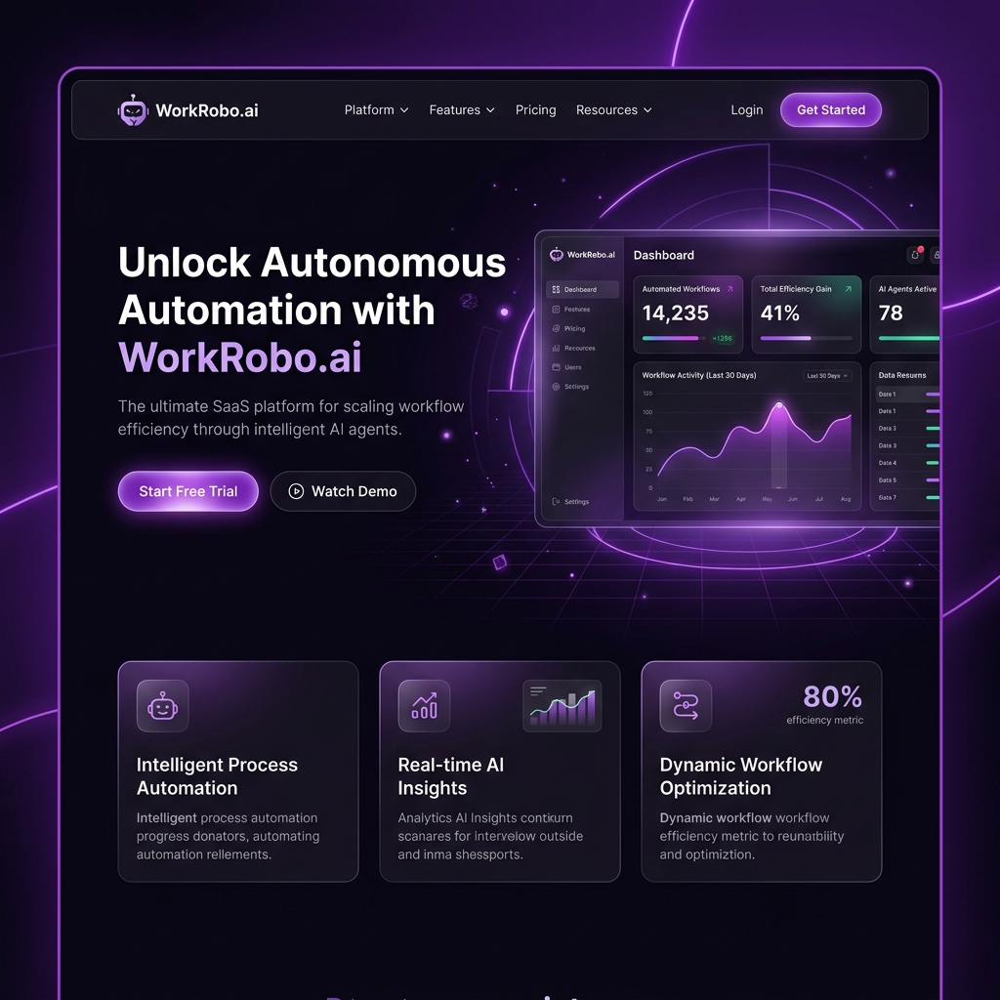
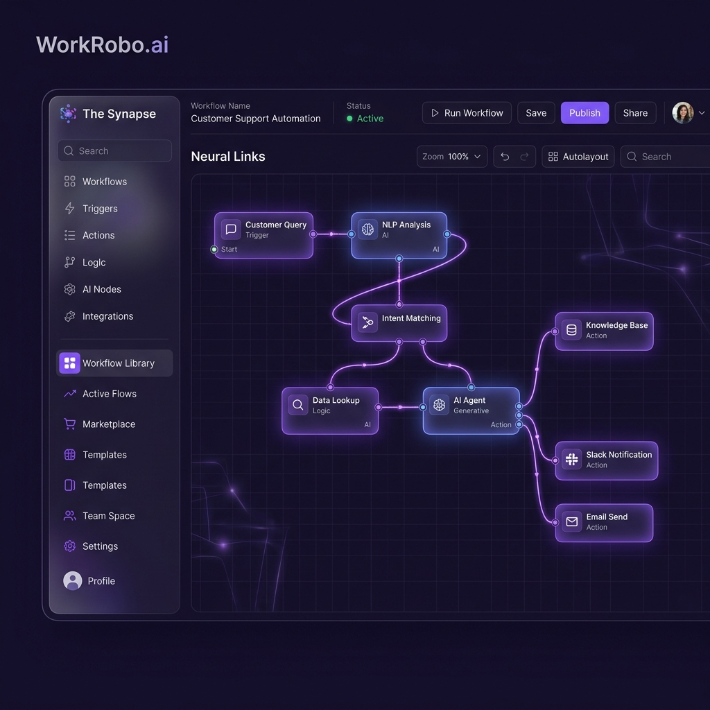
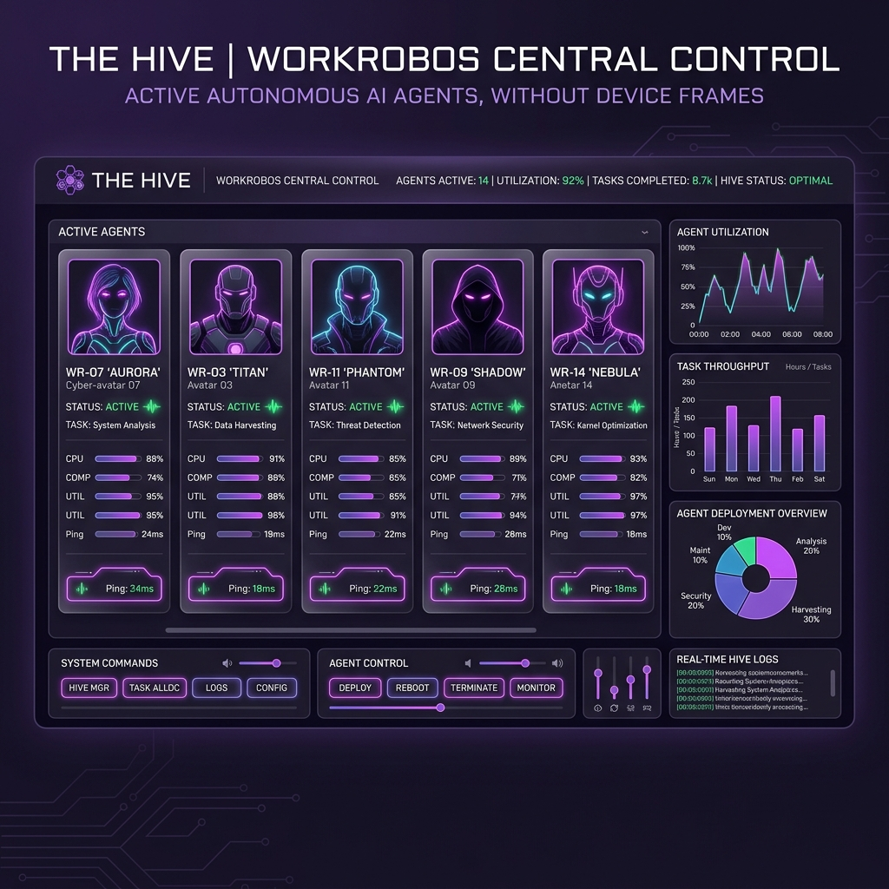

# WorkRobo.ai - All-in-One Autonomous Automation & Engagement Engine

WorkRobo.ai is a premium autonomous automation and email engagement SaaS platform. It combines visual node-based workflow orchestration, intelligent stealth web scraping, real-time updates via WebSockets, AI analysis powered by Gemini 3 Flash, and email messaging via Resend API.

---

## 🌟 Visual Showcase

### 1. Landing Page (3D & Glassmorphic Hero)
A premium dark landing page with neon glow elements, dynamic animations, and interactive dashboard stats designed to convert visitors.


### 2. The Synapse (Visual Workflow Builder)
An n8n-style canvas powered by ReactFlow. Connect triggers, web scrapers, AI processors, logic gates, and notification outputs. Features real-time execution node statuses and CSV downloads.


### 3. The Hive (Autonomous WorkRobo Agents)
Activate, pause, and monitor independent AI agents running in the background. Shows stats, triggers, and active telemetry logs.


---

## 🚀 Key Features

*   **The Synapse (Visual Builder)**: n8n-style drag-and-drop workflow orchestration using ReactFlow.
*   **The Sentry (Web Scraper)**: Playwright-based scraper running in stealth mode with automated retries and MD5-based change detection to bypass bot defenses.
*   **The Hive (AI Processing)**: Gemini AI nodes that output structured JSON, automatically extracting keys (like prices or features) to inject them as context variables.
*   **The Pulse (High-Scale Messaging)**: Subscriber/contact list management and Visual Email Builder integration via the Resend API.
*   **Hive-Clock (Background Scheduler)**: End-to-end cron job scheduler built on APScheduler to automate workflows without user presence.
*   **Real-time updates**: WebSocket communication mapping active execution state updates straight to the UI node blocks.

---

## 🛠 Tech Stack

### Backend (Python Engine)
*   **Core Framework**: FastAPI v2.0.0
*   **Database**: MongoDB (via `mongomock_motor` Async client for zero-friction sandbox testing)
*   **Background Tasks / Cron**: APScheduler (AsyncIOScheduler)
*   **Email Client**: Resend Python SDK
*   **AI Engine**: Gemini Python SDK (utilizing `gemini-2.0-flash`)
*   **Browser Scraping**: Playwright with stealth mode config

### Frontend (React Application)
*   **Framework**: React (built using CRA + Craco config)
*   **Animations**: Framer Motion
*   **Canvas Orchestration**: ReactFlow v11
*   **Styling**: Tailwind CSS with custom purple glassmorphism utility classes
*   **State / Fetching**: Axios, Supabase JWT auth interceptors, custom websocket hook (`useWorkflowWebSocket`)

---

## ⚙️ Project Setup

### Prerequisites
*   Python 3.10+
*   Node.js 18+ and npm/yarn

### 1. Backend Setup
1.  Navigate to the backend directory:
    ```bash
    cd WorkRobo.ai/backend
    ```
2.  Install dependencies:
    ```bash
    pip install -r requirements.txt
    ```
3.  Install Playwright browsers:
    ```bash
    playwright install chromium
    ```
4.  Configure `.env` file with your credentials:
    ```env
    MONGO_URL="mongodb://localhost:27017"
    DB_NAME="workrobo"
    CORS_ORIGINS="*"
    SUPABASE_URL="your-supabase-url"
    SUPABASE_ANON_KEY="your-anon-key"
    RESEND_API_KEY="your-resend-key"
    SENDER_EMAIL="onboarding@resend.dev"
    GEMINI_API_KEY="your-gemini-key"
    ```
5.  Start the FastAPI server:
    ```bash
    uvicorn server:app --port 8000 --reload
    ```

### 2. Frontend Setup
1.  Navigate to the frontend directory:
    ```bash
    cd WorkRobo.ai/frontend
    ```
2.  Install dependencies:
    ```bash
    npm install
    ```
3.  Configure `.env` file:
    ```env
    REACT_APP_BACKEND_URL=http://localhost:8000
    REACT_APP_SUPABASE_URL="your-supabase-url"
    REACT_APP_SUPABASE_ANON_KEY="your-anon-key"
    ```
4.  Start the local development server:
    ```bash
    npm start
    ```

---

## 🔀 Context Variable Injection & Logic

Subsequent nodes can pull values dynamically from previous steps using the standard double curly braces `{{variable_name}}` syntax:
*   `{{scraped_data}}` - Text content extracted by the last web scraping step.
*   `{{ai_summary}}` - JSON/text generated by the last AI processor node.
*   `{{trigger_data}}` - Context parameters passed from the initial trigger.

### Condition Node Branching
Condition nodes dynamically evaluate Python expressions like:
```python
price < 500 and change_detected == True
```
If evaluated to `True`, the execution traverses the green (upper) node handle. If `False`, it goes through the red (lower) handle.
